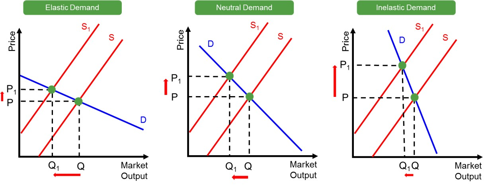
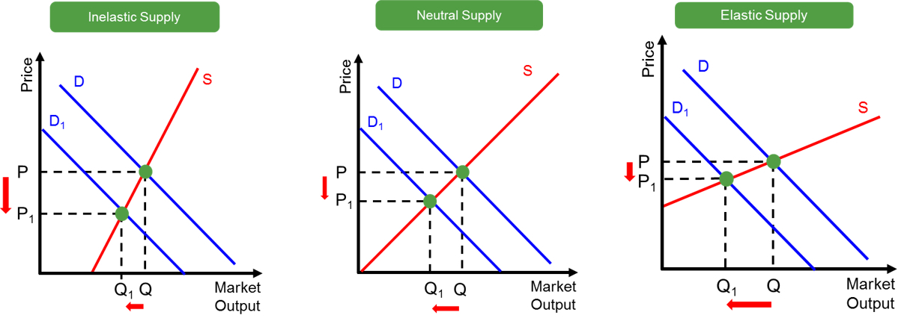

Have you ever wondered why people stop buying something when it gets too expensive, but keep buying other things no matter the price? Or why some products are quickly restocked when prices rise, while others take months? The answer lies in a key economic concept called **elasticity**.

Elasticity is a measure of how much the quantity demanded or supplied of a good changes in response to a change in price. It helps us understand consumer behavior, business decisions, and how the economy reacts to different situations.  
There are two major types of elasticity: **price elasticity of demand** and **price elasticity of supply**.

# Price Elasticity of Demand (PED)

Price elasticity of demand measures how much the quantity demanded changes in response to a price change. It indicates whether consumers significantly alter their buying behaviours when prices rise or fall. If a price change creates a large change in demand, it is considered elastic. If a price change creates a small or no change in demand, it is inelastic.

Several factors determine whether the demand for a product is elastic or inelastic:

1. Availability of substitutes: More substitutes \= more elastic demand.  
2. Necessity vs. luxury: Necessities \= inelastic; luxuries \= elastic.  
3. Time horizon: Demand becomes more elastic over time as consumers find alternatives.

Formula:  

<b>Price Elasticity of Demand (PED) = (% Change in Quantity Demanded) / (% Change in Price)</b>

* If  the absolute value of the result is greater than 1, demand is elastic, meaning it is sensitive to price changes   
* If the absolute value is less than 1, demand is inelastic, meaning it is not very sensitive to price changes   
* If the absolute value equals 1, demand is unitary elastic, meaning the percentage change in quantity demanded is equal to the percentage change in price 

# Price Elasticity of Supply (PES)

Price elasticity of supply measures how much the quantity supplied changes in response to a price change. It reflects how easily producers can adjust output when prices fluctuate.

Three main determinants of the price elasticity of supply:

1. Availability of inputs: Easier access to inputs \= more elastic supply.  
2. Time period: Supply becomes more elastic over time.  
3. Flexibility of production process: More flexible production \= more elastic supply.

Formula:  

<b>Price Elasticity of Supply (PES) = (% change in quantity supplied) / (% change in price)</b>

* If  |PES| is greater than 1, supply is elastic  
* If  |PES| is less than 1, supply is inelastic

# Examples

## PED

Take luxury cars as an example. If prices rise, many buyers delay purchases or choose cheaper models. Designer clothing is also elastic, as it is non-essential and has many substitutes. Similarly, airline tickets for leisure, restaurant meals, and non-essential electronics like tablets or gaming consoles see drops in demand when prices go up, since people can delay, cancel, or find alternatives.

## PES

Examples of PES include salt, toilet paper, gasoline, electricity, and water. Medical supplies like insulin and prescription drugs are also inelastic since they’re necessary for health. Addictive products such as cigarettes and alcohol tend to have stable demand despite price changes. Public transportation fares can be inelastic for those who rely on them with no alternatives.

# The Bottom Line

Elasticity of demand and supply is a key concept in understanding how prices affect buying and selling. Some goods respond quickly to price changes, while others do not. By knowing which products are elastic or inelastic, businesses can set better prices, and governments can make smarter policies. Whether you're a student, a business owner, or just curious, understanding elasticity helps you see how the economy works in real life.

# References

Khan Academy. (2019). *Price Elasticity of Demand and Price Elasticity of Supply*. Khan Academy. [https://www.khanacademy.org/economics-finance-domain/microeconomics/elasticity-tutorial/price-elasticity-tutorial/a/price-elasticity-of-demand-and-price-elasticity-of-supply-cnx](https://www.khanacademy.org/economics-finance-domain/microeconomics/elasticity-tutorial/price-elasticity-tutorial/a/price-elasticity-of-demand-and-price-elasticity-of-supply-cnx)